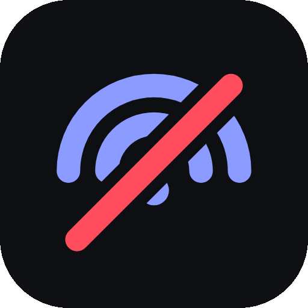
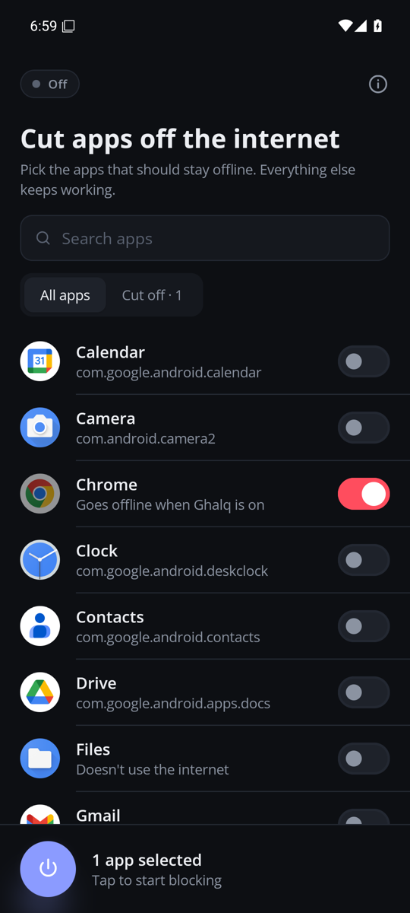
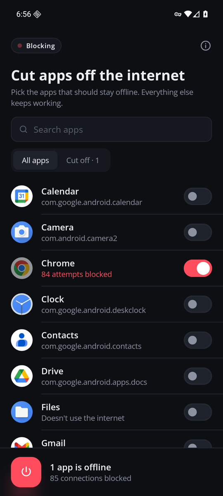
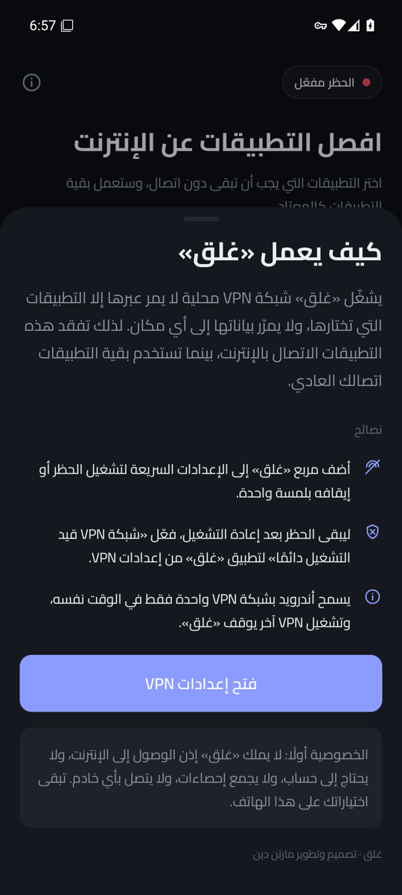

<p align="center">
  
</p>

<h1 align="center">Ghalq · غلق</h1>

<p align="center"><b>Cut chosen apps off the internet with one tap. No root, no server, no tracking.</b></p>

<p align="center">
  
  &nbsp;&nbsp;
  
  &nbsp;&nbsp;
  
</p>

<p align="center"><sub>Pick apps · Chrome cut off (84 attempts dropped, rest of the phone online) · Full Arabic RTL</sub></p>

**Ghalq** (Arabic غلق, "shutting") is a small Android firewall for people who want specific apps offline (a distracting
social app, a game that loads ads, an app you don't trust) while everything else keeps working.
Pick apps, press the button, done.

## Features

- **Per-app blocking.** Flip a switch next to any installed app.
- **One-tap power button** plus a **Quick Settings tile**.
- **Live feedback.** See how many connection attempts each blocked app made.
- **Changes apply instantly** while blocking is on; no restart needed.
- **Survives reboots** (restores itself, and supports Android's *Always-on VPN*).
- **English, Arabic (full RTL) and Norwegian**, light and dark theme.
- **Private by design:** the app does not even request the `INTERNET` permission.

## How it works

Ghalq uses Android's [`VpnService`](https://developer.android.com/reference/android/net/VpnService)
API as a local *blackhole*, the same technique used by well-known no-root firewalls.

```
Selected apps ──► local VPN tunnel (Ghalq) ──► packets read and discarded
Other apps    ──► normal Wi-Fi / mobile data
```

1. `Builder.addAllowedApplication()` puts **only** the selected apps into the tunnel.
2. The tunnel claims all IPv4 and IPv6 routes, so those apps have no other way out.
3. A sink thread reads each packet and drops it. It only peeks at headers to count new
   connection attempts (TCP SYN / new UDP flows) and, on Android 10+, attributes them to the app
   with `ConnectivityManager.getConnectionOwnerUid()`.

**Safety rule:** Android routes *every* app through a VPN that has no allow-list. Ghalq never
establishes a tunnel with an empty selection (`TunnelPlan`, covered by unit tests), so it can't
accidentally take the whole phone offline.

## Project layout

| Path | What it does |
|---|---|
| `vpn/GhalqVpnService.kt` | The blackhole tunnel, zero-gap rebuilds, revoke handling |
| `vpn/TunnelPlan.kt` | Decides which packages are routed; enforces the empty-selection rule |
| `vpn/PacketInspector.kt` | Minimal IPv4/IPv6 + TCP/UDP header parser for attempt counting |
| `vpn/GhalqTileService.kt` | Quick Settings tile |
| `vpn/BootReceiver.kt` | Restores blocking after reboot or update |
| `data/` | App list (launcher apps, icons) and saved choices |
| `ui/` | Jetpack Compose UI and theme |

## Verified behaviour

Tested on an Android 16 (API 36) emulator: with Chrome selected, `dumpsys connectivity` showed the
tunnel covering only Chrome's UID, Chrome could not load pages, Ghalq counted its dropped
connection attempts, and the rest of the system kept full connectivity. Switching off restored
Chrome immediately. Unit tests cover the tunnel plan and the packet parser.

## Build

Requirements: JDK 17+, Android SDK (platform 37). Android Studio is optional.

```bash
git clone https://github.com/MartinDean07/ghalq.git
cd ghalq
echo "sdk.dir=$HOME/Android/Sdk" > local.properties
./gradlew testDebugUnitTest assembleDebug
adb install app/build/outputs/apk/debug/app-debug.apk
```

Stack: Kotlin, Jetpack Compose, Material 3, AGP 9.5 (built-in Kotlin), min Android 8.0 (API 26),
target API 36.

## Limitations

- Android allows **one VPN at a time**. Ghalq can't run together with another VPN app.
- Anyone with access to the phone can turn the VPN off in Settings. Ghalq is a self-control and
  privacy tool, not tamper-proof parental control.
- A few privileged system components may bypass any VPN; ordinary apps are covered.

## License

MIT with an attribution requirement for commercial use. See [LICENSE](LICENSE).
Bundled fonts (Open Sans, Cairo) are under the SIL Open Font License 1.1.

The name *Ghalq* (غلق) is Arabic for "shutting" or "closing off".

Designed and built by **Martin Dean**.
